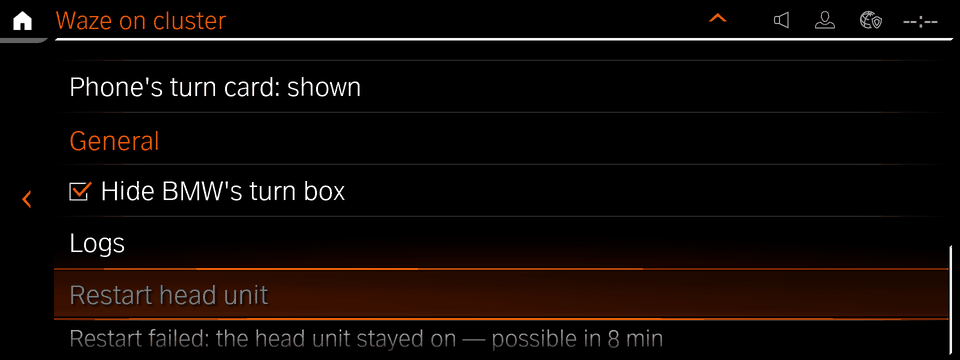

# robertn_waze_cluster

The HMI app for [waze-on-cluster](../../native/waze-on-cluster), which shows
the CarPlay cluster map (Waze, Apple Maps or Google Maps), or Android Auto's,
on the instrument cluster of an iDrive 7 (MGU) head unit. Everything is done from the HMI; no
shell is needed.

Install it from the catalog of
[idrive-apps](https://github.com/robertnisipeanu/idrive-apps)
through the [mgu Store](https://github.com/robertnisipeanu/mgu-store). It requires
waze-on-cluster 0.8.1, which brings the cluster renderer and writes the
CarPlay patch, and the Android Auto patch where the car supports it, as it
installs; one head-unit start activates them. After that
the map is on the cluster whenever CarPlay streams it, whether or not this
app is open.

Set **Instrument cluster > Central display area** to **Map view**: the Waze
map replaces the stock map while CarPlay's cluster stream shows a map, and
the stock map is back when the stream ends or shows none. Until a navigation
app draws on the cluster (in Waze or Google Maps, once a route starts), the
stock map stays and the map line shows `Waiting for the phone's map`.
**Off** works too, with an empty centre instead of the stock map. With
Route preview or Assisted Driving View the cluster's own content takes the
centre. After changing the setting, CarPlay may need reconnecting before
the map returns: the change can freeze the phone's cluster stream, and the
map line then shows `Map frozen` while the stock map (in Off, an empty
centre) shows.

To remove, remove the app in the Store, then the Waze tool, which reverts
the patch.

## The page

One `LT_State_Wide` list in three sections, each under a header row
(`LT_Label_Header_1Row`). Every row stays where it is: one that cannot act
now is greyed, and while `patchd` runs any operation (`busy`), every
operation in both sections is. A greyed button pressed sends nothing. The
restart's two rows, the last ones, are the only rows shown and hidden, so
nothing else moves when they come or go.

Both sections' status lines use the same words: `On`, `Off`, `Restart
pending`, `Removal pending`, `Applying…`, `Removing…`, `Failed`, `Not
supported on this car`, `Untested CarPlay version` / `Untested Android
Auto version`, `Changed by another tool`, `Status unavailable`,
`Incomplete`, `Connecting…`; CarPlay also `Update needed` (a patch from an
older app, which Enable map brings up to date).

| Section | Row | What it does |
|---|---|---|
| **CarPlay** | status | the patch's state, in the words above |
| | map | the map on the cluster: `Map off`, `Waiting for CarPlay`, `Waiting for the phone's map`, `Stream lost`, `Starting map…`, `Showing: Waze map — 16 frames/s`, `Map frozen`, `Map error`, `Map service unavailable` |
| | Enable map | applies the patch; enabled while it is off, unknown or out of date and no change is pending |
| | Disable map | reverts the patch, which turns the map off; enabled while patched and no change is pending |
| **Android Auto** | status | its patch's state, in the words above; `Failed` also while the last zoom or turn-card change failed |
| | Enable Android Auto | applies its patch; enabled while it is off or incomplete, supported and nothing is pending |
| | Disable Android Auto | reverts it; enabled while patched and nothing is pending |
| | Zoom | `Zoom: 180 dpi`, the density on disk; `(after restart)` while it differs from the one aapd runs until the next head-unit start; `Zoom` without the patch |
| | Zoom out / Zoom in | 10 dpi a press (150-400): out shows more map; enabled while patched, nothing is pending and the 10 s between changes has passed |
| | Phone's turn card | `Phone's turn card: shown` or `hidden`, on disk, with `(after restart)` as for the zoom: the phone's own turn card, cropped off the map while hidden; a press switches it; enabled as Zoom out and Zoom in |
| **General** | Hide BMW's turn box | a checkbox: ticked, BMW's turn-by-turn box on the cluster stays hidden while the map shows (the default); unticked, it shows. A press changes it at once and the map service keeps it. Greyed until the map service reports it; `Hide BMW's turn box — unavailable`, greyed and unticked, while the cluster renderer keeps the box shown |
| | Logs | opens the Logs page |
| | Restart head unit | the Node State Manager's normal head-unit restart; shown while a written change, CarPlay's or Android Auto's, waits for the next head-unit start; enabled while nothing runs and the restart limit (one every 10 minutes) allows it |
| | restart | shown while it has something to say: `Restarting…`, `Restart failed: not accepted` (NSM did not take it), `Restart failed: the head unit stayed on`, `Restart failed: command failed`, `Restart possible in 8 min` |

| | |
|---|---|
| CarPlay showing the map |  |
| CarPlay waiting |  |
| Android Auto on |  |
| Android Auto not supported |  |
| General |  |
| A change waiting for a restart |   |
| A restart that failed |  |
| The Logs page |  |

The **Logs** page (`ST_OnlineApps_WazeClusterLogs`, a child of the main
page):

| Row | What it does |
|---|---|
| Capture logs (5 min) / Stop capture | a bounded DLT capture for diagnostics; start it, then reconnect CarPlay |
| capture status | `Capture off`, `Starting capture…`, `Capturing`, `Stopping capture…`, `Capture failed`, `Capture unavailable` |
| Save logs | saves an archive of the tools' logs, kept journal and status (waze-on-cluster README, "Logs") |
| status | `Saving…`, `Saved <name>`, `<n> saved`, `No logs saved`, `Not enough space`, `Logs too large`, `Save failed`, `Logs unavailable`, `Connecting…` |
| QR code | the download address, for a phone on the car's Wi-Fi hotspot; blank without one |
| address | `http://172.16.222.97:8475/<token>/`, or `Wi-Fi hotspot off` |
| 5 rows | the saved archives, newest first, with their size |

The app holds the logs socket while the Logs page is visible; the logs
service serves the archives while it is held and for 15 minutes after a
save. The QR code is a PNG in `/dev/shm/robertn_waze_cluster_qr_<uid>/`
(`src/qr.js`, with Project Nayuki's QR code generator, `src/qrcodegen.js`),
replaced when the address changes and removed when the app shuts down.

`Starting map…` shows while the cluster renderer starts; a map error shows
only when the renderer stays unreachable for 15 s. Before the patch daemon
runs (right after the install), the pending patches are read from
`/dev/shm/waze-on-cluster/activation-pending` (CarPlay) and
`/dev/shm/waze-on-cluster/aa-pending` (Android Auto); a marker with
another boot's id is done, one without a boot id counts.

## The sockets

Unix stream sockets, newline-delimited JSON, group `tm_oap_app`. The app
holds the first two while one of its pages is visible and the third while
the Logs page is, and retries each once a second; the tools keep running
when it closes them.

- **Render** `/dev/shm/waze-on-cluster/ctl.sock`. The app sends
  `{"cmd":"guide","hide":0|1}` (Hide BMW's turn box). The tool sends
  `{"ev":"status","state","target","page","reason","upload_cap_kb_per_s","upload_reason","hide_bmw_guidance","guide_disabled"}`
  (`state` idle, starting, showing, frozen or error; `hide_bmw_guidance` 0
  or 1; `guide_disabled` 1 while the cluster renderer keeps the box shown),
  and `{"ev":"log","line"}`, which the app does not show.
- **Patch daemon** `/dev/shm/waze-on-cluster/patch.sock` (root). The app sends
  `{"cmd":"apply","panel":"high","mode":"avb"}`, `{"cmd":"revert"}`,
  `{"cmd":"aa-apply"}`, `{"cmd":"aa-revert"}`, `{"cmd":"aa-density","value"}`, `{"cmd":"aa-card","value"}`,
  `{"cmd":"reboot"}`, `{"cmd":"capture-start"|"capture-stop"}`. The daemon sends
  `{"ev":"status","state","panel","mode","res","safe","carplay","reason","pending","conflict","busy","restart","aa"}`
  (`aa`: `{"state","reason","conflict","pending","aapd","dpi","diskCard","runDpi","runCard","density","card","densities","changeAt","error"}`;
  `restart`: `{"state","code","reason","possibleAt"}`)
  (`state` original, patched, unknown, busy or error; `carplay: "deferred"`
  while a change waits for the next start), `{"ev":"capture",…}`,
  `{"ev":"reboot-reply","ok","reason"}`, `{"ev":"refused","cmd","reason"}`
  (a command not taken; it changes nothing on the page) and
  `{"ev":"log","line"}`, which the app does not show. waze-on-cluster's
  PATCH.md, "Activation", has the fields.
- **Logs** `/dev/shm/waze-on-cluster/logs.sock`; a connection starts the
  logs service. The app sends `{"cmd":"save"}`. The service sends
  `{"ev":"state","url","saving","error","saved","archives":[{"name","size","mtime"}]}`
  on connect and on each change (`url` null without the hotspot's address;
  `error` `no-space`, `too-large` or `failed`).

A patch with another sink, panel, size (not `1088x480`) or safe area (not
`504x368+286+72`) shows `Update needed`.

## Build and test

```sh
node tools/test_control.js           # the socket client against fake sockets
node tools/test_page.js              # the page against a fake SDK and HMI
node tools/build.js                  # robertn_waze_cluster@0.5.1.src.tgz
node tools/build.js --sdk <donor>    # also robertn_waze_cluster@0.5.1.tgz
```

The app ships as a source package (`mgu-app.json`; `"build": "unit"` in the
catalog). The repository carries no oap-sdk, which is BMW's: the head unit's
deploy tool links the app against the unit's own oap-sdk and takes the
package's entry point from the unit's own packages. To build the OAP tgz
locally, pass a donor bundle with `--sdk` (or `MGU_SDK_DONOR`), for example
the one `mgu-deploy.sh sdk-donor` takes from the unit. The tests need no
donor.

`node tools/fakes.js <render.sock> <patch.sock>` runs both fakes by hand;
Enter starts or stops a fake CarPlay stream.

| Path | |
|---|---|
| `src/robertn_waze_cluster.js` | the app |
| `src/waze_cluster_control.js` | the render and patch socket clients and the status logic |
| `src/logs_control.js` | the logs socket client |
| `src/qr.js`, `src/qrcodegen.js` | the QR code PNG; Project Nayuki's generator (MIT, `LICENSE-qrcodegen.txt`) |
| `tools/` | build, fakes, tests, icon |
| `robertn_waze_cluster@0.5.1/` | the package tree (manifest, RHMI UI, config) |

## License

GPL-3.0-or-later (`LICENSE`). Third-party files keep their own licenses.
