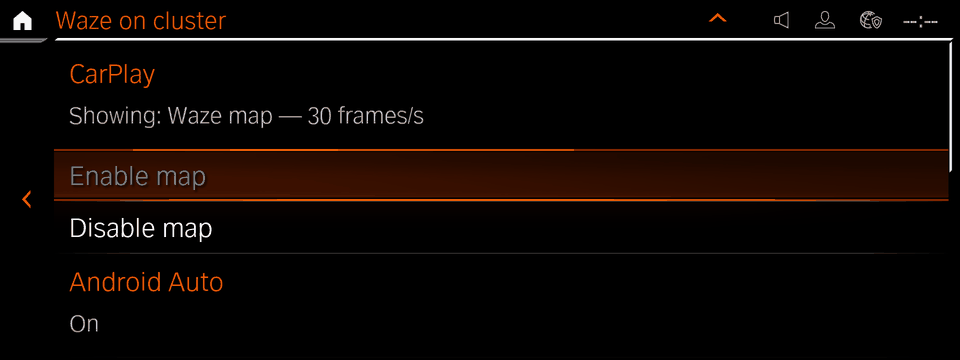
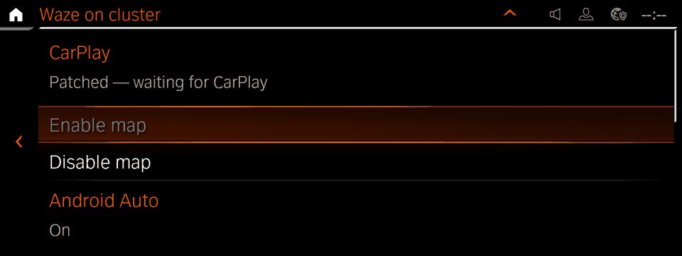
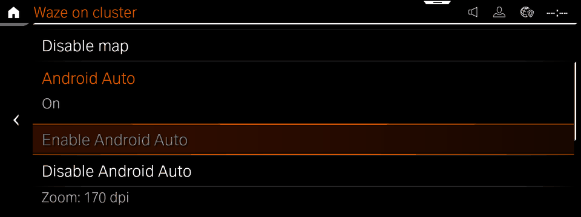
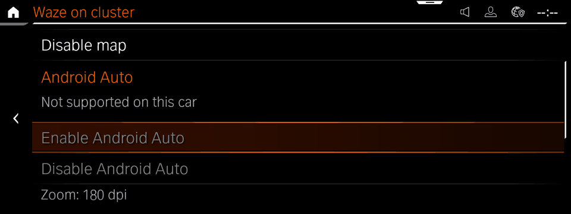
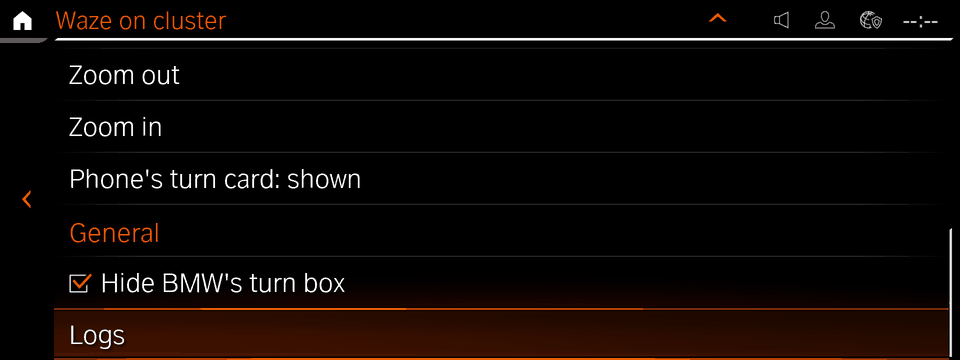
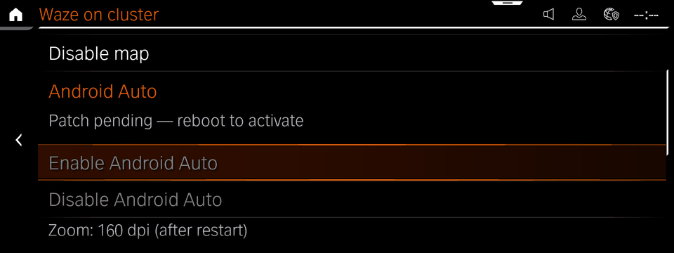
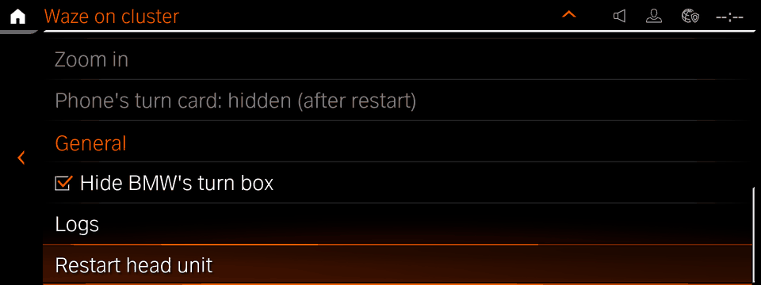
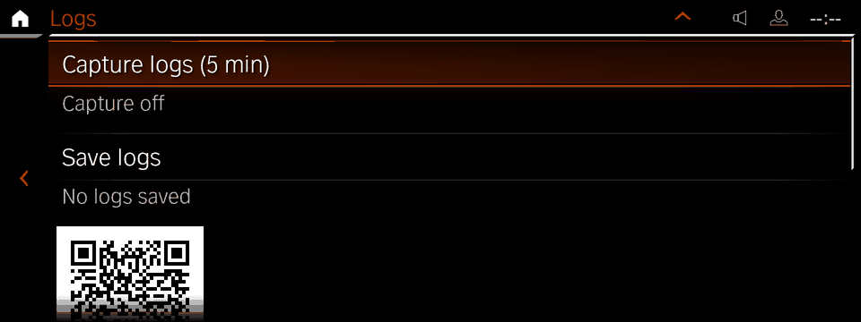

# robertn_waze_cluster

The HMI app for [waze-on-cluster](../../native/waze-on-cluster), which shows
the CarPlay cluster map (Waze, Apple Maps or Google Maps), or Android Auto's,
on the instrument cluster of an iDrive 7 (MGU) head unit. Everything is done from the HMI; no
shell is needed.

Install it from the catalog of
[idrive-apps](https://github.com/robertnisipeanu/idrive-apps)
through the [mgu Store](https://github.com/robertnisipeanu/mgu-store). It requires
waze-on-cluster 0.8.1, which brings the cluster renderer and writes the
CarPlay patch, and the Android Auto patch where the car supports it, as it
installs; one head-unit start activates them. After that
the map is on the cluster whenever CarPlay streams it, whether or not this
app is open.

Set **Instrument cluster > Central display area** to **Map view**: the Waze
map replaces the stock map while CarPlay's cluster stream shows a map, and
the stock map is back when the stream ends or shows none. Until a navigation
app draws on the cluster (in Waze or Google Maps, once a route starts), the
stock map stays and the page shows `Waiting for the phone's map — start
navigation`. **Off** works too, with an empty centre
instead of the stock map. With Route preview or Assisted Driving View the
cluster's own content takes the centre. After changing the setting, CarPlay
may need reconnecting before the map returns: the change can freeze the
phone's cluster stream, and the page then shows `Map frozen — reconnect
CarPlay` while the stock map (in Off, an empty centre) shows.

To remove, remove the app in the Store, then the Waze tool, which reverts
the patch.

## The page

One `LT_State_Wide` list in three sections, each under a header row
(`LT_Label_Header_1Row`). Every row stays where it is: one that cannot act
now is greyed. **Restart head unit** is the one row shown and hidden; it is
the last row, so nothing moves when it comes or goes.

| Section | Row | What it does |
|---|---|---|
| **CarPlay** | status | the patch and map state: `Patch pending — reboot to activate`, `Removal pending — reboot to finish`, `Original — enable the map`, `Not patched — <reason>`, `Applying patch…`, `Patched — waiting for CarPlay`, `Waiting for the phone's map — start navigation`, `Stream lost — reconnect CarPlay`, `Starting map…`, `Showing: Waze map — 16 frames/s …`, `Map frozen — reconnect CarPlay`, `Map error: …`, `Patch service unavailable (reboot may be needed)` |
| | Enable map | applies the patch; enabled while it is off, unknown or out of date and no change is pending |
| | Disable map | reverts the patch, which turns the map off; enabled while patched and no change is pending |
| **Android Auto** | status | `On`, `Off`, `Patch pending — reboot to activate`, `Removal pending — reboot to finish`, `Not supported on this car`, `Untested aapd build`, `Not on this head unit`, `Partly patched`, `Applying…`, `Reverting…`, `Another change running`, `Try again in a few seconds`, `Status unavailable`, `Not patched`, `Failed`, `Unavailable` |
| | Enable Android Auto | applies its patch; enabled while it is off or partly applied, supported and nothing is pending |
| | Disable Android Auto | reverts it; enabled while patched and nothing is pending |
| | Zoom | `Zoom: 180 dpi`, the density the phone is told; `(after restart)` while it waits for the next head-unit start |
| | Zoom out / Zoom in | 10 dpi a press (150-400): out shows more map; enabled while patched and nothing is pending |
| | Phone's turn card | `Phone's turn card: shown` or `hidden`, with `(after restart)` while it waits: the phone's own turn card, cropped off the map while hidden; a press switches it; enabled while patched and nothing is pending |
| **General** | Hide BMW's turn box | a checkbox: ticked, BMW's turn-by-turn box on the cluster stays hidden while the map shows (the default); unticked, it shows. A press changes it at once and the map service keeps it. Greyed until the map service reports it; `Hide BMW's turn box — unavailable`, greyed and unticked, while the cluster renderer keeps the box shown |
| | Logs | opens the Logs page |
| | Restart head unit | the Node State Manager's normal head-unit restart; shown only while a written change, CarPlay's or Android Auto's, waits for the next head-unit start, greyed once pressed |

| | |
|---|---|
| CarPlay showing the map |  |
| CarPlay waiting |  |
| Android Auto on |  |
| Android Auto not supported |  |
| General |  |
| A change waiting for a restart |   |
| The Logs page |  |

The **Logs** page (`ST_OnlineApps_WazeClusterLogs`, a child of the main
page):

| Row | What it does |
|---|---|
| Capture logs (5 min) / Stop capture | a bounded DLT capture for diagnostics; start it, then reconnect CarPlay |
| capture status | `Capture off`, `Starting capture…`, `Capturing — reconnect CarPlay now`, `Stopping capture…`, `Capture: <error>`, `Capture unavailable` |
| Save logs | saves an archive of the tools' logs, kept journal and status (waze-on-cluster README, "Logs") |
| status | `Saving…`, `Saved <name>`, `<n> saved`, `No logs saved`, `Not enough space`, `Logs too large`, `Save failed`, `Logs unavailable — restart head unit`, `Connecting…` |
| QR code | the download address, for a phone on the car's Wi-Fi hotspot; blank without one |
| address | `http://172.16.222.97:8475/<token>/`, or `Wi-Fi hotspot off` |
| 5 rows | the saved archives, newest first, with their size |

The app holds the logs socket while the Logs page is visible; the logs
service serves the archives while it is held and for 15 minutes after a
save. The QR code is a PNG in `/dev/shm/robertn_waze_cluster_qr_<uid>/`
(`src/qr.js`, with Project Nayuki's QR code generator, `src/qrcodegen.js`),
replaced when the address changes and removed when the app shuts down.

`Starting map…` shows while the cluster renderer starts; a map error shows
only when the renderer stays unreachable for 15 s. Before the patch daemon
runs (right after the install), the pending patches are read from
`/dev/shm/waze-on-cluster/activation-pending` (CarPlay) and
`/dev/shm/waze-on-cluster/aa-pending` (Android Auto).

## The sockets

Unix stream sockets, newline-delimited JSON, group `tm_oap_app`. The app
holds the first two while one of its pages is visible and the third while
the Logs page is, and retries each once a second; the tools keep running
when it closes them.

- **Render** `/dev/shm/waze-on-cluster/ctl.sock`. The app sends
  `{"cmd":"guide","hide":0|1}` (Hide BMW's turn box). The tool sends
  `{"ev":"status","state","target","page","reason","upload_cap_kb_per_s","upload_reason","hide_bmw_guidance","guide_disabled"}`
  (`state` idle, starting, showing, frozen or error; `hide_bmw_guidance` 0
  or 1; `guide_disabled` 1 while the cluster renderer keeps the box shown),
  and `{"ev":"log","line"}`, which the app does not show.
- **Patch daemon** `/dev/shm/waze-on-cluster/patch.sock` (root). The app sends
  `{"cmd":"apply","panel":"high","mode":"avb"}`, `{"cmd":"revert"}`,
  `{"cmd":"aa-apply"}`, `{"cmd":"aa-revert"}`, `{"cmd":"aa-density","value"}`, `{"cmd":"aa-card","value"}`,
  `{"cmd":"reboot"}`, `{"cmd":"capture-start"|"capture-stop"}`. The daemon sends
  `{"ev":"status","state","panel","mode","res","safe","carplay","reason","pending","conflict","aa"}`
  (`aa`: `{"state","reason","conflict","pending","aapd","dpi","diskCard","density","card","densities"}`)
  (`state` original, patched, unknown, busy or error; `carplay: "deferred"`
  while a change waits for the next start), `{"ev":"capture",…}`,
  `{"ev":"reboot-reply","ok","reason"}` and `{"ev":"log","line"}`, which the
  app does not show.
- **Logs** `/dev/shm/waze-on-cluster/logs.sock`; a connection starts the
  logs service. The app sends `{"cmd":"save"}`. The service sends
  `{"ev":"state","url","saving","error","saved","archives":[{"name","size","mtime"}]}`
  on connect and on each change (`url` null without the hotspot's address;
  `error` `no-space`, `too-large` or `failed`).

A patch with another sink, panel, size (not `1088x480`) or safe area (not
`504x368+286+72`) shows `Patched — Enable map to update the patch`.

## Build and test

```sh
node tools/test_control.js           # the socket client against fake sockets
node tools/test_page.js              # the page against a fake SDK and HMI
node tools/build.js                  # robertn_waze_cluster@0.5.1.src.tgz
node tools/build.js --sdk <donor>    # also robertn_waze_cluster@0.5.1.tgz
```

The app ships as a source package (`mgu-app.json`; `"build": "unit"` in the
catalog). The repository carries no oap-sdk, which is BMW's: the head unit's
deploy tool links the app against the unit's own oap-sdk and takes the
package's entry point from the unit's own packages. To build the OAP tgz
locally, pass a donor bundle with `--sdk` (or `MGU_SDK_DONOR`), for example
the one `mgu-deploy.sh sdk-donor` takes from the unit. The tests need no
donor.

`node tools/fakes.js <render.sock> <patch.sock>` runs both fakes by hand;
Enter starts or stops a fake CarPlay stream.

| Path | |
|---|---|
| `src/robertn_waze_cluster.js` | the app |
| `src/waze_cluster_control.js` | the render and patch socket clients and the status logic |
| `src/logs_control.js` | the logs socket client |
| `src/qr.js`, `src/qrcodegen.js` | the QR code PNG; Project Nayuki's generator (MIT, `LICENSE-qrcodegen.txt`) |
| `tools/` | build, fakes, tests, icon |
| `robertn_waze_cluster@0.5.1/` | the package tree (manifest, RHMI UI, config) |

## License

GPL-3.0-or-later (`LICENSE`). Third-party files keep their own licenses.
